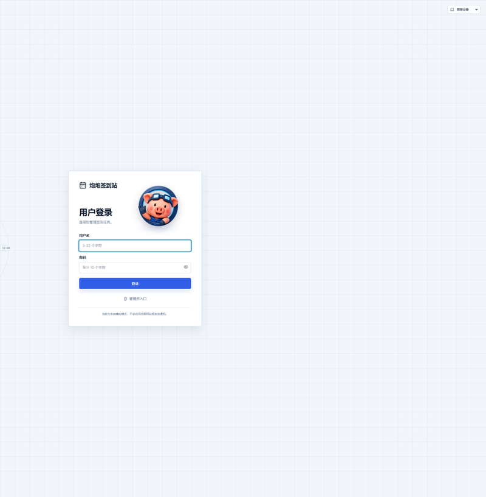
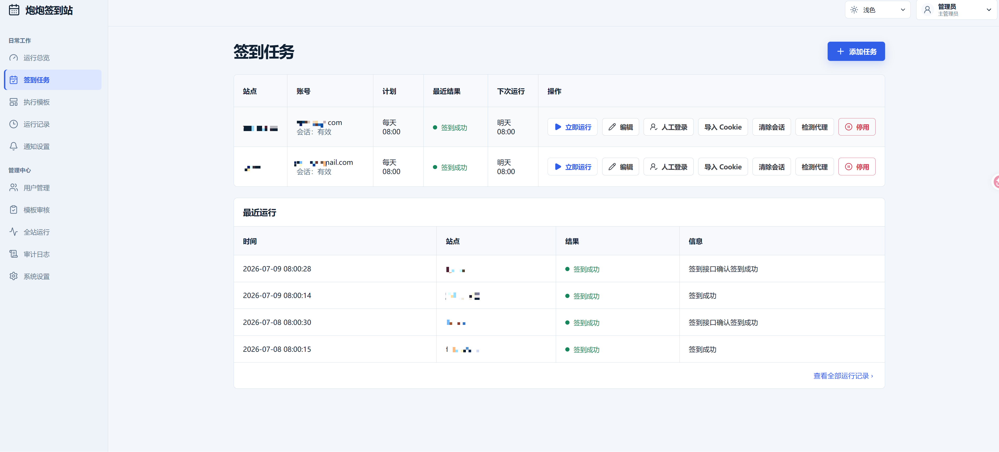

# 炮炮签到站 · Paopao Checkin Manager
多用户网页签到管理器。自动完成论坛、网站等日常签到任务，支持模板自定义、定时执行、失败重试与通知推送。
部署在自己的电脑或服务器上，通过浏览器访问管理面板操作。

当前正式版本：`0.9.1`（数据库迁移 v14）。




## 本地运行
```bash
git clone https://github.com/Natsuaki-forever/paopao-checkin-manager.git
cd paopao-checkin-manager
cp app/.env.production.example app/.env
cd app
npm ci
npm run dev
```
打开 `http://127.0.0.1:5173`，首次访问创建主密码（至少 10 个字符）后即可使用。
## Docker 部署
```bash
cd app
docker compose -f docker-compose.production.yml up -d --build
```
服务运行在 `http://127.0.0.1:8787`。
## 核心能力
- **自动化签到** — 浏览器表单填写、Cookie 会话复用、定时调度、失败重试
- **多用户体系** — 主管理员 / 运营管理员 / 普通用户三层权限，支持邀请注册
- **邀请管理** — 可生成可复用邀请码，主管理员可复制、删除并持续管理新生成的邀请码
- **模板系统** — 可复用的签到配置，支持 HAR 导入
- **通知推送** — 签到结果实时通知（成功 / 失败 / 异常）
- **安全设计** — 密码 Argon2id 哈希、凭据 AES-256-GCM 加密、验证码仅允许人工处理
- **三态主题** — 浅色 / 深色 / 跟随系统
## 技术栈
| 层 | 技术 |
| --- | --- |
| 前端 | React 19 + TypeScript + Vite |
| 后端 | Fastify 5 + SQLite (better-sqlite3) |
| 浏览器引擎 | Playwright |
| 容器化 | Docker |
## 文档
- [完整开发参考](docs/REFERENCE.md)
- [项目概览](docs/PROJECT_OVERVIEW.md)
- [正式发布与回退](docs/PRODUCTION_ROLLOUT.md)
- [长期 UX 质量参考](docs/UX_QUALITY_REFERENCE.md)
- [版本变更](CHANGELOG.md)

